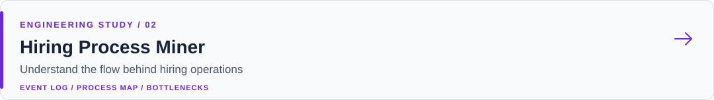
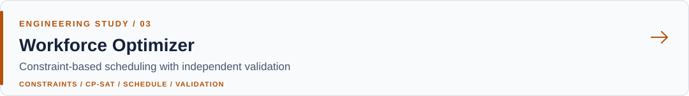
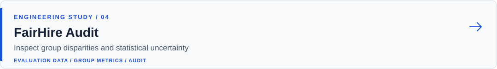
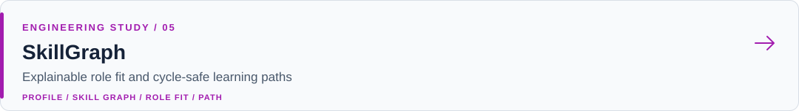

# Hasan Hüseyin Yetkiner

**Embedded software & systems engineer**

C++ / Qt / Linux · Cybersecurity · Backend systems · Applied AI

I build software across devices, operational systems, and intelligent applications. My focus is dependable behavior: clear interfaces, reproducible checks, and explicit engineering trade-offs.

[Portfolio](https://hasanhuseyinyetkiner.github.io/) · [LinkedIn](https://linkedin.com/in/hasan-huseyin-yetkiner) · [Email](mailto:hasanhuseyinyetkiner@gmail.com) · [All repositories](https://github.com/hasanhuseyinyetkiner?tab=repositories)

## Engineering across the stack

My background spans embedded C/C++ and Qt/QML, Linux, industrial connectivity, network and cybersecurity engineering, backend services, and local AI tooling. I am interested in the boundary between a working prototype and a system whose behavior can be understood and checked.

- **Devices and systems:** embedded Linux, C/C++, Qt/QML, serial and network communication, HMI and media pipelines.
- **Services and tooling:** Python, TypeScript, REST, PostgreSQL, CI/CD and test automation.
- **Applied AI and security:** retrieval, local inference, evaluation, network analysis and secure system design.

## Featured collection · HR engineering

Five independent products explore evidence-backed retrieval, process mining, constraint solving, responsible model evaluation and graph reasoning. Each is a local demo built around synthetic data, with documented limits and reproducible tests.

[HR Policy Copilot](https://github.com/hasanhuseyinyetkiner/hr-policy-copilot) — version-aware hybrid retrieval and cited policy answers.

[Hiring Process Miner](https://github.com/hasanhuseyinyetkiner/hiring-process-miner) — process maps, bottlenecks and event-log quality.

[Workforce Optimizer](https://github.com/hasanhuseyinyetkiner/workforce-optimizer) — CP-SAT scheduling with independent validation.

[FairHire Audit](https://github.com/hasanhuseyinyetkiner/fairhire-audit) — group disparities, uncertainty and threshold exploration.

[SkillGraph](https://github.com/hasanhuseyinyetkiner/skillgraph) — explainable role fit and cycle-safe learning paths.

The products support analysis and exploration; they do not make hiring or promotion decisions. Follow a project link for real interface screenshots, architecture, setup and evaluation evidence.

## More public work

- [**codextractor**](https://github.com/hasanhuseyinyetkiner/codextractor) — a Python CLI for packaging repository context into structured Markdown.
- [**pop-lingo**](https://github.com/hasanhuseyinyetkiner/pop-lingo) — Linux desktop hover translation and dictionary workflows.
- [**Qt-SmartID-Reader-Service**](https://github.com/hasanhuseyinyetkiner/Qt-SmartID-Reader-Service) — C++/Qt smart-card and serial-reader integration.

## Experience and approach

My work has included C++/Qt manufacturing software, industrial communication and engineering leadership at Mepsan; C++/Qt/QML and real-time video workflows in defense-related projects at Baykar; robotics work involving ROS and LiDAR; and network operations and reliability. I have also introduced automated checks, CI/CD workflows, pytest, QEMU-based testing and static analysis into development processes. Technologies are not implied to have been used at every organization.

I value **correctness**, measurable results, documented trade-offs and security as part of the design. A useful demo should expose both its evidence and its limits.

**Education:** MSc in Computer Engineering in progress at Selçuk University; postgraduate specialization in Cybersecurity and Critical Infrastructure Protection at Università del Salento; double-major background in Electrical-Electronics Engineering and Computer Engineering.

[README design and asset maintenance](docs/README_DESIGN.md)
